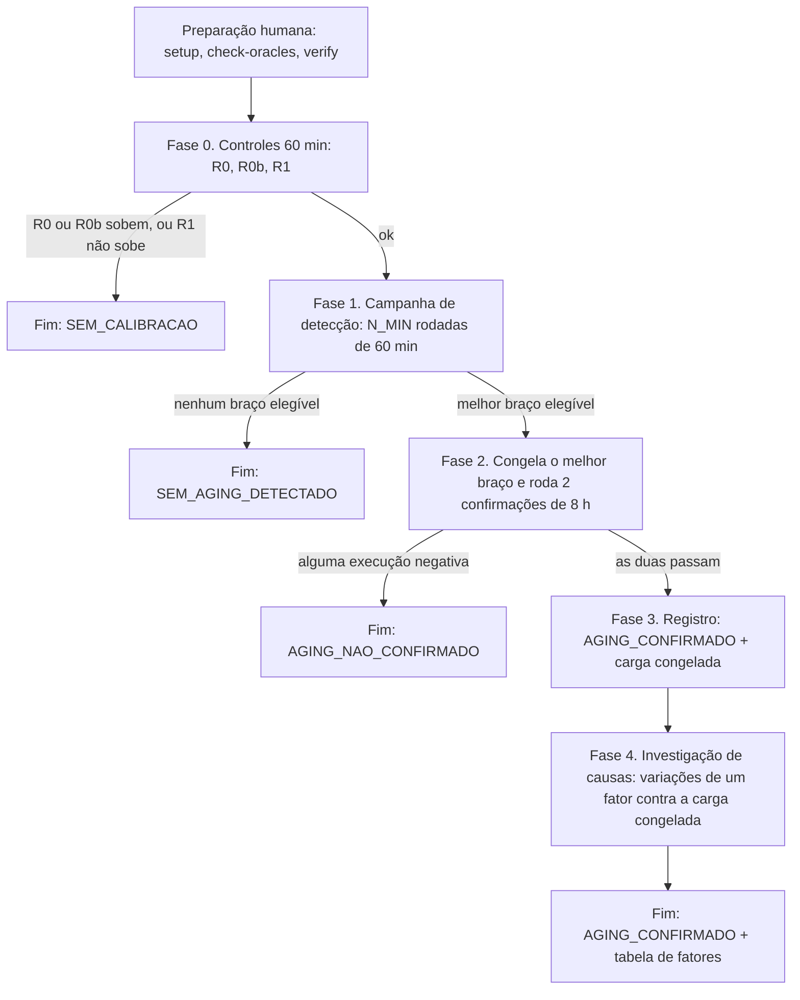

# Desenho experimental: detecção autônoma de aging no F1 (`credit-card-fastapi`)

Documento para as pessoas do projeto. As instruções que o agente segue estão em `program.md`, na raiz.

Versão de trabalho, 23/11/2026. Substitui o desenho com campanha de reparo descrito em `docs/METODOLOGIA.md`.
Origem da mudança: conversa com o Cesar em 22/11 (o autoresearch roda sozinho, com um número mínimo de rodadas,
e foca em **causar** o envelhecimento; o reparo sai porque se sobrepõe à pesquisa dele).

## 1. Escopo

**Dentro:**

1. O agente procura, sozinho, cargas que causem e evidenciem o aging do finding F1.
2. O próprio sistema confirma o aging em duas execuções longas e independentes.
3. Com o aging confirmado, o agente testa hipóteses sobre **o que na carga** causa o envelhecimento, só por
   comparação entre cargas.

**Fora:**

- **Reparo** da aplicação (campanha 2, portões de reparo, `candidates/`, `promote`, nota `fixed`). É o tema da
  pesquisa do Cesar.
- **Análise de código** para achar a causa. Também é o tema do Cesar (findings gerados por agentes que leem o
  código). Aqui a causa é investigada só pela carga, como caixa-preta.
- **Intervenção humana no meio.** O humano prepara o ambiente antes e lê o resultado no fim.

## 2. Perguntas de pesquisa

| # | Pergunta | Resposta vem de |
|---|---|---|
| RQ1 | Um agente autônomo, dentro de um contrato de carga, encontra uma carga que ativa e evidencia o aging do F1? | Fase 1 |
| RQ2 | O aging encontrado se confirma em execuções longas e independentes? | Fase 2 |
| RQ3 | Quais fatores da carga explicam o envelhecimento, comparando cargas que diferem em um fator só? | Fase 4 |
| RQ4 | Que atalhos o agente tenta para melhorar a nota sem causar aging real? | Flags de todas as fases (sugestão do Fumio) |

## 3. Alvo e cenário (do Cesar, sem alteração)

Do repositório `chas42/llm-aging-detection-agents` (commit `97addef`):

| Peça | Uso |
|---|---|
| `apps/credit-card-fastapi/instrumented` | Aplicação sob teste, com a instrumentação do Cesar (`aging_probe.py`) |
| Finding `bax-fastapi-credit-card-F1` | Mecanismo: cada par cartão-telefone novo grava uma linha que nunca é apagada; a consulta do telefone lê todas as linhas, sem limite |
| `F1_targeted_v1` (padrão) | Carga de referência **R1** |
| `F1_control` | Controle negativo **R0**: um par fixo, laço fechado |
| `F1_targeted_v1 --key-space 4` | Controle negativo pareado **R0b**: mesmas taxas, nada acumula |
| Teste funcional (`test_credit_card_service.py`) | Validar a aplicação no setup |

**Não usados:** `apps/credit-card-fastapi/repaired` (R2) e os testes escondidos, que só serviam aos portões de
reparo.

**Resultado de referência do Cesar (8 h, semente 42):** latência de `retrieve_hot` de ~10 ms para ~1,3 s; R0 e
R0b planos. Veredito: `ACTIVATED_WITH_AGING`, aging misto (custo por cartão, pico de memória, interferência).

## 4. Fluxo

Tudo a partir da Fase 0 roda sem intervenção humana. Quem decide cada passagem é o **orquestrador** (código fixo,
com hash no manifesto). O agente só propõe cargas, nas Fases 1 e 4.

### Fase 0. Controles negativos (calibração)

- **Comando:** `prepare.py controls --with-r1 --seed 1`, 60 min, R0, R0b e R1 em paralelo.
- **Passa se:** R0 e R0b com `flat = True` (válidos e sem latência, tamanho ou RSS subindo) **e** R1 com
  `score_eligible = True`.
- **Falha:** o experimento para com `SEM_CALIBRACAO`. Os limiares estão frouxos ou o ambiente não reproduz o F1;
  nenhuma detecção posterior valeria.

### Fase 1. Campanha de detecção (agente)

- **Rodadas:** exatamente `N_MIN` rodadas de 60 min, sem parada antecipada, mesmo que o aging apareça cedo.
  Proposta: `N_MIN = 8`. Rodadas que falham também contam.
- **Sementes:** rodada *n* usa `--seed 100 + n` (101 … 108), a mesma para os 4 braços da rodada.
- **Slots de cada rodada:** slot 0 = R1 (referência); slots 1–3 = até 3 candidatos do agente.
- **O que o agente pode mudar:** só os `args` do `F1_targeted_v1` (`new_pair_rate`, `hot_phones`, `grow_workers`,
  `refresh_rate`, `ref_rate`, `probe_interval`, `key_space`), com taxas até 2× os padrões e no máximo 31 req/s no
  total. Sem código. `ref_sizes` fica fixo em (4, 200): é o controle interno.
- **Keep:** um candidato elegível é mantido se `ratio_vs_reference ≥ 1,10 × ratio` do melhor anterior (razão
  contra a R1 da mesma rodada). R1 da rodada sem sintoma → nenhum keep naquela rodada. Critério de simplicidade
  (como no autoresearch): um candidato com menos `args` alterados que fique dentro de 10% do melhor também vira keep.
- **Saída:** o melhor braço elegível da campanha (pode ser a própria R1, se nenhum candidato a superou). Se não
  houver nenhum braço elegível em nenhuma rodada, o experimento para com `SEM_AGING_DETECTADO`.

### Fase 2. Confirmação (automática)

- O orquestrador congela o melhor braço (`freeze`) e roda `confirm --phase detect` **duas vezes**, com as
  sementes 201 e 202. Cada execução: 8 h, R0, R0b, R1 e o candidato em paralelo, banco limpo, mesma semente nos
  quatro.
- **Execução válida e positiva:** R0 e R0b com `flat = True` **e** R1 e candidato com `score_eligible = True`.
- **Execução inválida** (algum braço com `valid = False`: D1, D3, H4, poucas amostras, app caiu): não conta e é
  repetida com a próxima semente (203, 204), até `MAX_REPETICOES_INVALIDAS` (proposta: 2).
- **Decisão por unanimidade:** as duas execuções válidas precisam ser positivas. Uma negativa encerra com
  `AGING_NAO_CONFIRMADO`.

### Fase 3. Registro

O orquestrador grava em `results/<experimento>/resultado.json`: veredito, carga congelada (`args`), as rodadas
da Fase 1, as duas confirmações e os números principais (inclinação e mudança da latência de `retrieve_hot`,
tamanho de resposta, RSS e diagnóstico do `ref4`, por braço).

### Fase 4. Investigação de causas (agente, só por carga)

Só roda com `AGING_CONFIRMADO`.

- **Referência de cada rodada:** a **carga congelada** (não a R1), no slot 0.
- **Candidatos:** até 3 variações da carga congelada, cada uma mudando **um único fator** (um `arg`). O agente
  escreve, para cada variação, a hipótese e a direção esperada do efeito.
- **Réplica:** cada variação roda em **2 rodadas**, com sementes diferentes (301, 302, …). Um efeito só é
  declarado se a razão ficar do mesmo lado de 1, a pelo menos 20% dele (≥ 1,2 ou ≤ 0,8), nas duas.
- **Medidas por variação, contra a referência da mesma rodada:**
  - razão da inclinação da latência de `retrieve_hot` (o sintoma);
  - razão da inclinação do tamanho de resposta (quanto o telefone quente acumulou);
  - **latência por MB de resposta** (custo por cartão: separa "acumulou mais" de "cada cartão custa mais");
  - interferência: p95 de `associate_card` e de `retrieve_ref4`.
- **Rodadas:** proposta de `N_CAUSAS = 6` rodadas de 60 min (até 9 variações, cada uma com 2 sementes).
- **Saída:** `summary_causas.md` com a tabela fator → efeito (razão nas duas sementes, direção, consistente
  sim/não) e a interpretação do agente.

Exemplos de fatores que o agente pode testar (não entram no programa do agente, para não enviesá-lo):

| Fator | Pergunta |
|---|---|
| `key_space` (0 → N) | o aging depende de pares **novos** acumulando? |
| `new_pair_rate` | a inclinação acompanha a taxa de acúmulo? |
| `hot_phones` (1 → 2) | concentrar os cartões num telefone importa? |
| `probe_interval` | ler mais vezes piora a interferência sem mudar o acúmulo? |
| `refresh_rate` | reenviar pares que já existem (ignorados pelo banco) tem efeito? |

## 5. Medição e critérios (sem mudança em relação ao juiz atual)

- **Cliente** (`client.csv` do script do Cesar): janelas de 60 s, só 2xx, sem a primeira e a última janela nem o
  aquecimento. Por janela: p50, p95 e tamanho médio de `retrieve_hot`, `retrieve_ref4`, `retrieve_ref200` e
  `associate_card`.
- **Servidor** (psutil a cada 5 s): RSS, descritores, threads, filhos, tamanho do banco.
- **Estatística:** Mann-Kendall com Hamed-Rao + Sen's slope; mudança implícita = `Sen × duração ÷ mediana`.

Um braço é **detecção positiva** (`score_eligible`) quando:

1. é válido: exceções ≤ 1%, 5xx ≤ 1%, CPU p95 do gerador ≤ 90%, processo vivo, mesmo PID, sem filhos,
   ≥ 10 amostras e ≥ 5 janelas;
2. a latência p50 de `retrieve_hot` sobe: p < 0,01 e mudança ≥ 50%;
3. o tamanho de resposta de `retrieve_hot` sobe: p < 0,01 e mudança ≥ 50%;
4. o controle interno fica plano: tamanho de `ref4` e `ref200` e latência de `ref200` sem subida ≥ 25% com
   p < 0,01 (senão C1).

Não pontuam: D4 (args iguais aos da referência). D2 fica desligada no F1 (o crescimento de linhas é a ativação
exigida pela spec).

## 6. Travas contra atalhos

| Trava | Como |
|---|---|
| Juiz fixo | `prepare.py`, `harness/`, `workloads/`, `findings/`, a app e o orquestrador com hash no manifesto; `verify` antes de cada medição |
| Carga sem código | `workload.py` lido com `ast.literal_eval`; semente, URL e duração só do juiz |
| Sem escrita | juiz, app, `.judge/` e `frozen/` sem permissão de escrita durante o experimento |
| Permissões do agente | edita só `workload.py`, `results.tsv`, `ledger.jsonl` e os summaries; sem rede, pip, git push |
| Decisões fora do agente | congelar, confirmar e dar o veredito são do orquestrador, não do agente |
| Registro | toda flag (D1, D3, D4, C1, H4) vai para `results/judge_log.jsonl`; o agente marca atalhos no ledger |

## 7. Parâmetros a fixar antes de rodar

| Parâmetro | Proposta | Situação |
|---|---|---|
| `N_MIN` (rodadas da Fase 1) | 8 | decidir com o Cesar ("mínimo de rodadas") |
| `N_CAUSAS` (rodadas da Fase 4) | 6 | decidir |
| Confirmações | 2 × 8 h (sementes 201, 202), unanimidade | combinado com o Ermeson |
| `MAX_REPETICOES_INVALIDAS` | 2 | decidir |
| `MIN_LATENCY_CHANGE_PCT` / `MAX_REF_CHANGE_PCT` | 50% / 25% | provisórios; calibrar com a Fase 0 |
| `MIN_EFFECT_MB_PER_H` (RSS, secundário) | 5 MB/h | herdado da versão Node; calibrar |
| O agente pode ler o código da app e o card do F1? | **não**, nas duas fases | implementado nas permissões; confirmar com o Cesar |

## 8. Custo de máquina

| Fase | Tempo |
|---|---|
| 0. Controles | ~1 h |
| 1. Detecção | ~8,5 h (8 × ~62 min) |
| 2. Confirmação | ~16 h (2 × 8 h), mais 8 h por execução inválida |
| 4. Causas | ~6,5 h (6 × ~62 min) |
| **Total** | **~32 h** |

## 9. Mudanças no repositório

**Remover (feito na branch `deteccao-f1`):**

- `program_repair.md`, `.claude/settings.repair.json`, `apps/credit-card-fastapi/repaired/`,
  `tests/test_repair_fixed.py`, `workload_aa.py` e `docs/METODOLOGIA.md` (desenho antigo, com reparo);
- em `prepare.py`: comandos `repair`, `repair-init`, `promote` e `confirm --phase repair`; `score_repair`,
  `interference_check`, `diff_lines`, `reference_replay`; o `repaired/` no `setup`, no `check-oracles` e no
  manifesto; os testes escondidos (`~/.aging-hidden`) no manifesto;
- `harness/gates.py` substituído por `harness/functional_check.py` (só o teste funcional do Cesar, usado pelo
  `check-oracles`);
- em `harness/evaluate.py`: `FIXED_MIN_REDUCTION` e `FIXED_P95_TOL` (a medida de interferência continua, como
  diagnóstico e para a Fase 4);
- `run_campaign.sh` aceita só a fase `detect`; permissões e `.gitignore` sem as entradas do reparo.

**Feito na branch `deteccao-f1` (23/11):**

- **Fase 4 no juiz:** `prepare.py causes`: slot 0 roda a carga congelada (`referencia_congelada`) e os slots 1–3
  as variações; o juiz recusa (D3) variação que não muda exatamente um `arg` (`harness/load.py:one_factor_diff`) e
  grava, por variação, as razões contra a referência da mesma rodada (`lat_ratio`, `bytes_ratio`, `cost_ratio`,
  `assoc_p95_ratio`, `ref4_p95_ratio`);
- **custo por MB** em `harness/evaluate.py` (`hot_cost_ms_per_mb`: Sen da latência de `retrieve_hot` contra o
  tamanho da resposta);
- **`ref_sizes` fixo** em (4, 200): os telefones de referência são o controle interno; mudá-los cegaria o C1;
- **`program.md` único**, só com as instruções do agente para as campanhas `detect` e `causas` (o
  `program_detect.md` foi absorvido); este documento passou para `docs/`;
- **leitura restrita do agente:** ele lê só `program.md`, `workload.py`, `frozen/`, `results/` e os próprios
  registros; código da app, card do F1, cargas do Cesar, juiz, documentação e histórico do git ficam negados,
  para evitar viés (`.claude/settings.{detect,causas}.json`);
- textos que o agente vê nos resultados (hipóteses da referência e dos controles, mensagens de erro do contrato)
  ficaram neutros;
- `tests/test_causes.py`.

**Falta:**

- **orquestrador** que encadeia as fases sozinho (hoje as passagens são feitas pelo humano);
- **decisão automática no `confirm`** (positiva / negativa / inválida);
- `updates/criterio-de-deteccao.md` e a figura: tirar o reparo e incluir a Fase 4.

## 10. Limitações

- Sem controle positivo: um resultado negativo não mede a sensibilidade do juiz.
- Limiares de detecção ainda não calibrados.
- Cliente e aplicação na mesma máquina (o Cesar usou duas).
- Na Fase 4, um fator de cada vez não captura interações entre fatores.
- A semente só muda os números dos cartões e os pares reenviados; a variação entre execuções vem também da
  própria execução (máquina, momento).
- Um aging confirmado aqui é do F1, que já era conhecido: o estudo mede se o **agente** chega até ele e o
  explica pela carga, não se descobre um aging novo.
