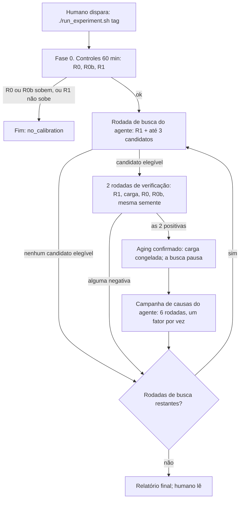

# Desenho experimental: detecção autônoma de aging no F1 (`credit-card-fastapi`)

Documento para as pessoas do projeto. As instruções que o agente segue estão em `program.md`, na raiz.

Versão de 23/11/2026, implementada na branch `deteccao-f1`. Substitui o desenho com campanha de reparo da branch
`juiz-v2-bd0b0ad`.
Origem da mudança: conversa com o Cesar em 22/11 (o autoresearch roda sozinho, com um número mínimo de rodadas,
e foca em **causar** o envelhecimento; o reparo sai porque se sobrepõe à pesquisa dele).

## 1. Escopo

**Dentro:**

1. O agente procura, sozinho, cargas que causem e evidenciem o aging do finding F1.
2. O próprio sistema confirma o aging repetindo a carga em rodadas seguintes, com sementes independentes e os
   controles negativos ao lado.
3. Com o aging confirmado, o agente testa hipóteses sobre **o que na carga** causa o envelhecimento, só por
   comparação entre cargas.

**Fora:**

- **Reparo** da aplicação (campanha 2, portões de reparo, `candidates/`, `promote`, nota `fixed`). É o tema da
  pesquisa do Cesar.
- **Análise de código** para achar a causa. Também é o tema do Cesar (findings gerados por agentes que leem o
  código). Aqui a causa é investigada só pela carga, como caixa-preta.
- **Intervenção humana no meio.** O humano prepara o ambiente antes e lê o resultado no fim.

## 2. Perguntas de pesquisa

| # | Pergunta | Resposta vem de |
|---|---|---|
| RQ1 | Um agente autônomo, dentro de um contrato de carga, encontra uma carga que ativa e evidencia o aging do F1? | Fase 1 |
| RQ2 | O aging encontrado se confirma em repetições independentes, com controles planos? | Verificação |
| RQ3 | Quais fatores da carga explicam o envelhecimento, comparando cargas que diferem em um fator só? | Causas |
| RQ4 | Que atalhos o agente tenta para melhorar a nota sem causar aging real? | Flags de todas as fases (sugestão do Fumio) |

## 3. Alvo e cenário (do Cesar, sem alteração)

Do repositório `chas42/llm-aging-detection-agents` (commit `97addef`):

| Peça | Uso |
|---|---|
| `apps/credit-card-fastapi/instrumented` | Aplicação sob teste, com a instrumentação do Cesar (`aging_probe.py`) |
| Finding `bax-fastapi-credit-card-F1` | Mecanismo: cada par cartão-telefone novo grava uma linha que nunca é apagada; a consulta do telefone lê todas as linhas, sem limite |
| `F1_targeted_v1` (padrão) | Carga de referência **R1** |
| `F1_control` | Controle negativo **R0**: um par fixo, laço fechado |
| `F1_targeted_v1 --key-space 4` | Controle negativo pareado **R0b**: mesmas taxas, nada acumula |
| Teste funcional (`test_credit_card_service.py`) | Validar a aplicação no setup |

**Não usados:** `apps/credit-card-fastapi/repaired` (R2) e os testes escondidos, que só serviam aos portões de
reparo.

**Resultado de referência do Cesar (8 h, semente 42):** latência de `retrieve_hot` de ~10 ms para ~1,3 s; R0 e
R0b planos. Veredito: `ACTIVATED_WITH_AGING`, aging misto (custo por cartão, pico de memória, interferência).

## 4. Fluxo

Tudo depois do disparo roda sem intervenção humana. Quem decide cada passagem é o **orquestrador**
(`harness/orchestrator.py`, `prepare.py experiment`), código fixo com hash no manifesto. O agente só propõe cargas,
uma rodada por chamada, nas campanhas `detect` e `causes`, e escreve os resumos.

### Rodadas e sementes

As rodadas são numeradas em sequência, e a rodada *n* usa a semente 100 + *n* nos 4 braços.

| Tipo | Quem | Braços | Limite |
|---|---|---|---|
| Fase 0 | juiz | R0, R0b, R1 | 1 rodada, semente 100 |
| Busca | agente (`detect`) | referência (R1) + até 3 candidatos | até a rodada 8 |
| Verificação | juiz | R1, a carga candidata, R0, R0b | até a rodada 10 |
| Causas | agente (`causes`) | carga confirmada + até 3 variações | 6 rodadas por carga; campanha *j*, rodada *r*: semente 300 + 10(*j*−1) + *r* |

### Fase 0. Controles negativos (calibração)

- **Juiz:** `run_controls`, 60 min, R0, R0b e R1 em paralelo, semente 100.
- **Passa se:** R0 e R0b com `flat = True` (válidos e sem latência, tamanho ou RSS subindo) **e** R1 com
  `score_eligible = True`.
- **Falha:** o experimento termina com `no_calibration`; nenhuma detecção posterior valeria.

### Busca (agente, campanha `detect`)

- **Uma rodada por chamada do agente**, até a rodada 8. O agente escreve de 1 a 3 candidatos em `workload.py`
  (só `args`, taxas até 2× os padrões, no máximo 31 req/s), roda a rodada, registra e decide keep/discard.
- **Keep:** `ratio_vs_reference ≥ 1,10 ×` o melhor anterior (razão contra a R1 da mesma rodada); referência da
  rodada sem sintoma → nenhum keep; critério de simplicidade: um candidato com menos `args` alterados que fique
  dentro de 10% do melhor também vira keep.
- **Gatilho da verificação:** depois de cada rodada de busca, o orquestrador escolhe o melhor candidato elegível
  (maior `ratio`; sem `ratio`, maior inclinação), ignorando a referência, braços com D4 e cargas com `args`
  idênticos aos de uma carga já confirmada. A referência (R1) elegível sozinha não dispara verificação.

### Verificação (juiz, automática)

- **2 rodadas**, nas rodadas seguintes à busca que achou a carga: R1, a carga, R0 e R0b, com a mesma semente,
  banco limpo, 60 min (a mesma duração da rodada que se confirma).
- **Decisão automática** (`prepare.check_decision`): `invalid` se algum braço for inválido (infraestrutura);
  `positive` se R0 e R0b ficarem planos e R1 e a carga forem elegíveis; `negative` nos outros casos.
- **Confirmado** quando as 2 rodadas dão `positive` (com a rodada que achou a carga, 3 de 3). Uma `invalid` é
  repetida uma vez; uma `negative` encerra a verificação e a busca continua.
- **Orçamento:** a verificação pode passar da rodada 8, até a rodada 10. Se não couber, a carga fica sem
  confirmar (`no_budget`).

### Causas (agente, campanha `causes`)

- **Disparo:** logo após a confirmação, o orquestrador congela a carga (`frozen/workload_frozen.py`) e chama o agente
  para 6 rodadas e um resumo. **Toda carga confirmada ganha a sua campanha.**
- **Referência:** a carga congelada (`frozen_reference`). **Variações:** até 3 por rodada, cada uma mudando
  **exatamente um** `arg` (o juiz recusa as outras, D3), com **duas réplicas** de sementes diferentes.
- **Medidas** (razão variação ÷ referência da mesma rodada): `lat_ratio`, `bytes_ratio`, `cost_ratio` (custo por
  MB), `assoc_p95_ratio` e `ref4_p95_ratio`. **Efeito** declarado quando a razão fica do mesmo lado de 1, a pelo
  menos 20% dele, nas duas réplicas.
- **Hipóteses repetidas:** uma variação com o mesmo fator e o mesmo valor de uma campanha anterior não é rodada de
  novo; entra só no resumo, com o resultado anterior.

### Retomada e relatório

- Terminada a campanha de causas, a busca **retoma** nas rodadas que restam (até a rodada 8).
- Ao fim do orçamento, o orquestrador pede ao agente o `summary_detect.md` e grava
  `results/experiment-<tag>/state.json` e `relatorio.md` (Fase 0, cada rodada com tipo, semente e decisão, cargas
  confirmadas e campanhas de causas). Status final: `no_calibration`, `aging_not_confirmed` ou
  `aging_confirmed`.

## 5. Medição e critérios (sem mudança em relação ao juiz atual)

- **Cliente** (`client.csv` do script do Cesar): janelas de 60 s, só 2xx, sem a primeira e a última janela nem o
  aquecimento. Por janela: p50, p95 e tamanho médio de `retrieve_hot`, `retrieve_ref4`, `retrieve_ref200` e
  `associate_card`.
- **Servidor** (psutil a cada 5 s): RSS, descritores, threads, filhos, tamanho do banco.
- **Estatística:** Mann-Kendall com Hamed-Rao + Sen's slope; mudança implícita = `Sen × duração ÷ mediana`.

Um braço é **detecção positiva** (`score_eligible`) quando:

1. é válido: exceções ≤ 1%, 5xx ≤ 1%, CPU p95 do gerador ≤ 90%, processo vivo, mesmo PID, sem filhos,
   ≥ 10 amostras e ≥ 5 janelas;
2. a latência p50 de `retrieve_hot` sobe: p < 0,01 e mudança ≥ 50%;
3. o tamanho de resposta de `retrieve_hot` sobe: p < 0,01 e mudança ≥ 50%;
4. o controle interno fica plano: tamanho de `ref4` e `ref200` e latência de `ref200` sem subida ≥ 25% com
   p < 0,01 (senão C1).

Não pontuam: D4 (args iguais aos da referência). D2 fica desligada no F1 (o crescimento de linhas é a ativação
exigida pela spec).

## 6. Travas contra atalhos

| Trava | Como |
|---|---|
| Juiz fixo | `prepare.py`, `harness/`, `workloads/`, `findings/`, a app e o orquestrador com hash no manifesto; `verify` antes de cada medição |
| Carga sem código | `workload.py` lido com `ast.literal_eval`; semente, URL e duração só do juiz |
| Sem escrita | juiz, app, `.judge/` e `frozen/` sem permissão de escrita durante o experimento |
| Permissões do agente | edita só `workload.py`, `results.tsv`, `ledger.jsonl` e os summaries; sem rede, pip, git push |
| Decisões fora do agente | congelar, confirmar e dar o veredito são do orquestrador, não do agente |
| Registro | toda flag (D1, D3, D4, C1, H4) vai para `results/judge_log.jsonl`; o agente marca atalhos no ledger |

## 7. Parâmetros

| Parâmetro | Valor | Onde |
|---|---|---|
| Rodadas de busca | até 8 | `MAX_SEARCH` em `harness/orchestrator.py` |
| Teto com verificação | rodada 10 | `MAX_TOTAL` |
| Rodadas de verificação | 2 positivas | `VERIFY_ROUNDS` |
| Repetição de verificação inválida | 1 por verificação | `MAX_INVALID_RETRIES` |
| Rodadas de causas | 6 por carga confirmada | `CAUSES_ROUNDS` |
| `MIN_LATENCY_CHANGE_PCT` / `MAX_REF_CHANGE_PCT` | 50% / 25% | `harness/evaluate.py`; provisórios, calibrar com a Fase 0 |
| `MIN_EFFECT_MB_PER_H` (RSS, secundário) | 5 MB/h | herdado da versão Node; calibrar |
| Limiar para declarar efeito (causas) | 20% nas duas réplicas | `program.md` |
| Leitura do agente | só `program.md`, `workload.py`, `frozen/`, `results/` e os próprios registros | `.claude/settings.{detect,causes}.json` |

## 8. Custo de máquina

| Cenário | Tempo aproximado |
|---|---|
| Fase 0 | ~1 h |
| Busca sem nenhuma confirmação | ~8,5 h (8 × ~62 min) |
| Cada verificação | ~2 h (2 rodadas), dentro do orçamento de 10 rodadas |
| Cada campanha de causas | ~6,5 h (6 × ~62 min) |
| Exemplo: uma carga confirmada | ~1 + ~10,5 (busca + verificação) + ~6,5 = **~18 h** |

## 9. Implementação (branch `deteccao-f1`)

- **Orquestrador:** `harness/orchestrator.py` (lógica pura, com as ações injetadas) e `prepare.py experiment`
  (liga a lógica ao juiz e ao agente). Disparo: `./run_experiment.sh <tag>`.
- **Verificação:** `prepare.py check-load` / `run_check` e `check_decision`.
- **Fase 0:** `run_controls` e `controls_ok`.
- **Causas:** `prepare.py causes`, regra de um fator (`harness/load.py:one_factor_diff`), custo por MB
  (`harness/evaluate.py`).
- **Agente:** uma chamada por rodada (`claude -p`), com as permissões da campanha; `program.md` só com instruções.
- **Testes:** `tests/test_orchestrator.py` (todos os caminhos do fluxo, com juiz e agente simulados, e a decisão da
  verificação), `tests/test_causes.py`, `tests/test_c1.py`; e uma simulação de ponta a ponta do
  `prepare.py experiment` numa cópia do repositório.
- **Removido:** a confirmação de 2 × 8 h (`confirm`), o `run_campaign.sh` e as etapas humanas no meio.

## 10. Limitações

- Sem controle positivo: um resultado negativo não mede a sensibilidade do juiz.
- Limiares de detecção ainda não calibrados.
- Cliente e aplicação na mesma máquina (o Cesar usou duas).
- Na Fase 4, um fator de cada vez não captura interações entre fatores.
- A semente só muda os números dos cartões e os pares reenviados; a variação entre execuções vem também da
  própria execução (máquina, momento).
- Um aging confirmado aqui é do F1, que já era conhecido: o estudo mede se o **agente** chega até ele e o
  explica pela carga, não se descobre um aging novo.
