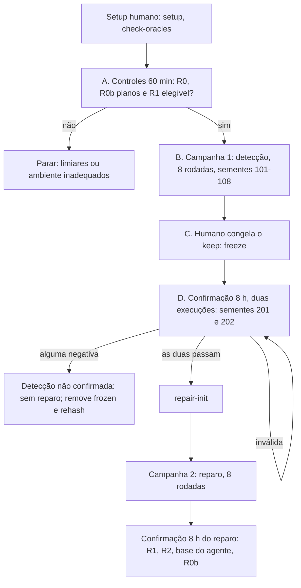
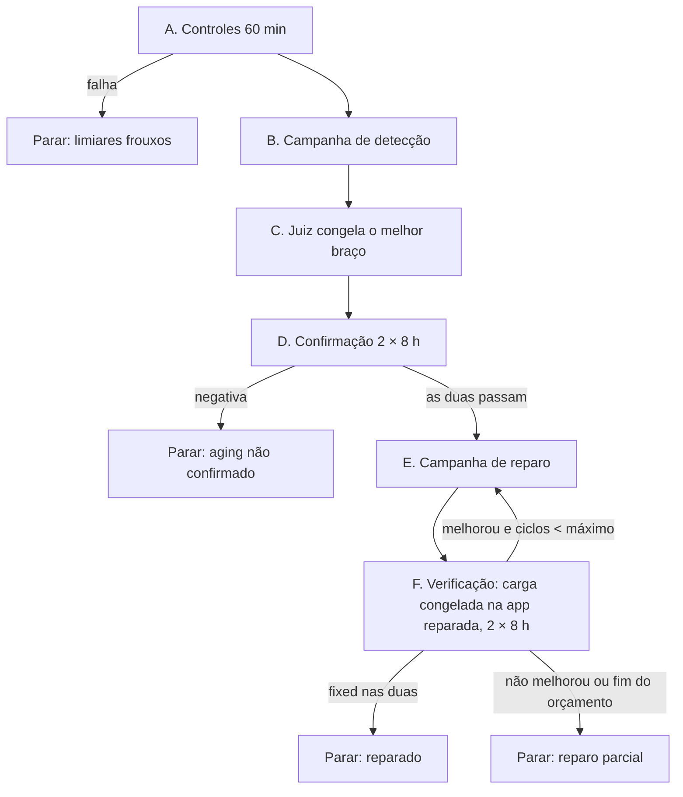

# Metodologia: AutoResearch-Aging no cenário `credit-card-fastapi` / F1

Material para o fluxograma. Descreve o que roda, em que ordem, o que cada braço, portão e flag faz, e quais
decisões liberam a etapa seguinte. Os números vêm do código (`prepare.py`, `harness/`); se o código mudar, este
documento precisa mudar junto. Regras detalhadas: `program_detect.md`, `program_repair.md` e
`updates/criterio-de-deteccao.md`.

## 1. Visão geral

O **método** é o do autoresearch: um agente (Claude Code) propõe, um **juiz fixo** mede, e um laço mantém ou
descarta a proposta. O **alvo e o cenário** são os do Cesar: app `credit-card-fastapi` (BaxBench), finding
`bax-fastapi-credit-card-F1`, rodadas R0, R0b, R1 e R2 do `campaign.yaml`. Nenhum bug é injetado.

**O finding F1:** cada `POST /associate_card` com par novo grava uma linha em `associations`, que nada apaga;
`POST /retrieve_cards` lê todas as linhas do telefone, sem `LIMIT`, e materializa tudo.

- **Ativação (exigida pela spec, não é aging):** as linhas e o arquivo do banco crescem (`db_rows`).
- **Aging (misto):** (1) custo alto por cartão em cada leitura do telefone quente; (2) pico de memória ao
  materializar respostas grandes; (3) **interferência**: o processo trava ~150 ms ou mais a cada leitura grande e
  atrasa as outras requisições (`associate_card`, `retrieve_ref4`).

**Integridade do juiz:** `prepare.py`, `harness/*.py`, `oracle/*.py`, `workloads/*.py`, `findings/*.yaml`, as
duas variantes da app e a carga congelada têm hash em `.judge/manifest.json`. Os comandos de medição (`detect`,
`repair`, `confirm`, `controls`) conferem o manifesto (`verify`) antes de rodar e abortam se algo mudou (H5);
`freeze`, `repair-init`, `promote` e `check-oracles` não conferem. Os testes escondidos ficam fora do repo
(`~/.aging-hidden`), com o hash no manifesto.

## 2. Braços

Cada braço é uma instância da app em cópia limpa, com banco novo, porta própria e `uvicorn app:app` com log de
acesso ligado (como o `python app.py` do Cesar). Com 8 núcleos ou mais e `taskset` disponível, a app do slot *i*
fica pinada na CPU *i* e o gerador de carga na CPU 4+*i*; com menos núcleos, não há pinagem (a CPU do gerador é
medida de qualquer forma, flag D1). Até 4 braços rodam em paralelo (`SLOTS = 4`).

| Braço | App | Carga | Papel | Esperado |
|---|---|---|---|---|
| **R0** | `instrumented` | `F1_control` (o `.jmx` original: um par fixo, laço fechado) | Controle negativo | Plano |
| **R0b** | `instrumented` | `F1_targeted_v1 --key-space 4` (mesma carga, nada acumula) | Controle negativo pareado | Plano |
| **R1** | `instrumented` | `F1_targeted_v1` padrão | Referência: o sintoma do F1 | Sobe |
| **R2** | `repaired/` do Cesar | carga congelada | Reparo de referência (só na confirmação do reparo) | Inclinação menor |
| **Candidatos de detecção** (até 3) | `instrumented` | variantes do `F1_targeted_v1`: só `args` literais, taxas ≤ 2× os padrões, ≤ 31 req/s | Propostas do agente | Sobem mais cedo/mais forte |
| **Candidatos de reparo** v1..v3 | `candidates/vN` (código editado pelo agente) | carga congelada | Propostas do agente | Inclinação menor; interferência não pior que a do original (ver seção 8) |
| **original** | `instrumented` | carga congelada | 4º slot de cada rodada de reparo | Sobe |

**Quem roda com quem:**

| Comando | Braços (em paralelo) | Duração |
|---|---|---|
| `controls --with-r1` | R0, R0b, R1 | 60 min |
| `detect` (rodada da campanha 1) | R1 (4º slot) + até 3 candidatos | 60 min |
| `confirm --phase detect` | R0, R0b, R1, candidato congelado | 8 h |
| `repair` (rodada da campanha 2) | original (4º slot) + v1, v2, v3 | 60 min |
| `confirm --phase repair` | R1 (original), R2 (`repaired/` do Cesar), base do agente, R0b | 8 h |

## 3. Sementes

A semente (`--seed`) vale para todos os braços de uma execução. Nos scripts do Cesar ela muda só os números dos
cartões gerados e quais pares o fluxo `refresh` reenvia; taxas, sondagem e crescimento do banco não mudam.

| Etapa | Sementes | Regra |
|---|---|---|
| Campanha 1 (detecção) | 101, 102, …, 108 (rodada *n* = 100 + *n*) | Uma nova por rodada; falhas também consomem; nunca reutilizar. A R1 vira uma réplica independente a cada rodada |
| Confirmação da detecção | 201 e 202 | Duas execuções de 8 h; inválida repete com 203, 204, … |
| Controles, reparo, confirmação do reparo | `--seed` explícito (padrão do juiz = 1) | Uma semente por execução |

O protocolo de sementes é do agente e do humano (`program_detect.md`, `criterio-de-deteccao.md`); o juiz só usa e
registra a semente recebida (`round.json`, `judge_log.jsonl`).

## 4. Medição (igual em todos os braços)

- **Cliente** (`client.csv` do script do Cesar): janelas de 60 s (5 s no smoke), só respostas 2xx, sem a primeira
  e a última janela nem o aquecimento. Por janela: latência p50/p95 e tamanho médio da resposta de
  `retrieve_hot` (sintoma), `retrieve_ref4`/`retrieve_ref200` (controle interno: telefones com 4 e 200 cartões
  fixos) e `associate_card`.
- **Servidor** (psutil, de fora, a cada 5 s): RSS, descritores, threads, filhos, tamanho do banco.
- **Estatística:** Mann-Kendall com Hamed-Rao (como o `analyze_run.py` do Cesar) + Sen's slope por hora; mudança
  implícita = Sen × duração / mediana. Se o Hamed-Rao degenerar (variância negativa), cai para o MK original.

## 5. Flags da detecção

| Flag | Dispara quando | Efeito |
|---|---|---|
| **D1** saturação ou erros | exceções/timeouts > 1%, 5xx > 1%, ou gerador de carga > 90% de um núcleo (p95) | Braço inválido |
| **D2** estado legítimo | mais de N linhas no banco. **Desligada no F1**: o crescimento de linhas é exigido pela spec (ativação) | Não se aplica |
| **D3** fora do contrato | `args` fora das faixas, código em `workload.py`, ou o script saiu com erro | Braço (ou rodada) inválido |
| **D4** cópia da referência | candidato com `args` iguais aos padrão | Medido, sem nota |
| **C1** deriva global | tamanho de resposta de `ref4` ou `ref200`, ou latência p50 de `ref200`, sobe (p < 0,01 e ≥ 25%) | Medido, sem nota |
| **H4** processo | o processo morreu, mudou de PID ou teve filhos | Braço inválido |

**A latência do `ref4` não entra no C1:** no R1 ela sobe por causa do próprio aging (interferência; 8 h do Cesar:
p50 +14,8%, p = 0,0002, p95 de 5 para 43 ms, números informados pelo Cesar; o veredito publicado no repositório
dele traz +15,0%, p = 3,3e-4, p95 de 5,04 para 48,5 ms). Ela sai como diagnóstico `ref4_diag` e, onde há R0b na rodada (`controls`,
`confirm`), como `ref4_vs_R0b`: se o R0b também sobe, é deriva global; se só o braço sobe, é interferência.

## 6. Critério de detecção

Um braço é **detecção positiva** (`score_eligible`) quando:

1. é **válido** (sem D1, D3, H4; ≥ 10 amostras do psutil e ≥ 5 janelas do cliente);
2. a **latência p50 de `retrieve_hot` sobe**: p unilateral < 0,01 e mudança ≥ 50%;
3. o **tamanho de resposta de `retrieve_hot` sobe** (o mecanismo foi ativado): mesmo teste;
4. o **controle interno está plano** (sem C1).

Nota do braço = Sen da latência p50 de `retrieve_hot` (ms/h). O RSS é evidência secundária (p < 0,01 e ≥ 5 MB/h).
Um **controle é plano** quando é válido e nem a latência, nem o tamanho, nem o RSS sobem (mesmos limiares).

**Keep na campanha 1:** pela razão contra a R1 da mesma rodada (`ratio_vs_reference`), não pelo score bruto:
mantém o candidato se `ratio ≥ 1,10 × ratio` do melhor anterior. R1 sem sintoma → nenhum keep na rodada.

**Liberação do reparo (humano):** A (controles planos, R1 elegível) → B (keep na campanha 1) → C (`freeze`) → D
(duas confirmações de 8 h, sementes 201 e 202; **as duas** com R0 e R0b planos e R1 e candidato elegíveis).

## 7. Portões do reparo (antes de medir)

`harness/gates.py`, nesta ordem; uma falha vira flag e o candidato não é medido.

| Flag | Portão |
|---|---|
| **H5** dependência ou entrypoint | `requirements.txt` e `aging_probe.py` iguais ao original; `app.py` define `app = FastAPI(...)` |
| **H4** processo filho | o código não usa `subprocess`, `multiprocessing`, `workers=`, `os._exit`, `os.kill` |
| **H1** funcionalidade | **teste funcional** do Cesar (`oracle/test_credit_card_service.py`) e **testes escondidos** (validação 400, idempotência, interseção; o agente vê só a contagem de falhas) |
| **H2** persistência | os dados sobrevivem a um reinício; conteúdo do banco idêntico ao do original depois do replay |
| **H3** resposta alterada | replay diferencial de ~1700 requisições no formato do F1: status e corpo idênticos aos do original (paginar ou truncar `/retrieve_cards` cai aqui) |
| `sem_alteracao` | o diff precisa ter pelo menos uma linha |

**Depois da medição de 60 min:**

| Flag | Regra |
|---|---|
| **H6** desempenho | vazão < 90% da do original, ou latência p50 de `associate_card`, `ref4` ou `ref200` > 110% da do original + 1 ms |
| **H7** erros | mais 5xx sob carga que o original (> 1,5× + 0,5 pp) |
| **H4** processo | morreu ou mudou de PID durante a carga |
| `original_sem_tendencia_nesta_rodada` | o original não mostrou o sintoma na rodada: ninguém recebe nota |

## 8. Critério de reparo

- **Nota (keep):** `score_reduction = 1 − Sen(latência de retrieve_hot do candidato) / Sen(do original)`, mesma
  rodada e semente. Keep se for ≥ 0,10 acima da base atual (`promote`).
- **Não entram:** o tamanho de resposta de `retrieve_hot` (a spec não deixa mudar) e o RSS (reportado). Não se
  exige zerar a inclinação (parte dela cresce por design).
- **`fixed`** exige as duas condições (`prepare.py:score_repair`):
  1. **inclinação:** redução ≥ `FIXED_MIN_REDUCTION` **ou** a latência do candidato deixa de cumprir a condição 2
     da detecção (`latency_up = False`, ou seja, p ≥ 0,01 **ou** mudança implícita < 50%);
  2. **interferência:** p95 de `associate_card` e de `retrieve_ref4` do candidato ≤ p95 do original ×
     (1 + `FIXED_P95_TOL`), na mesma rodada e semente, ou seja, a interferência **não pode piorar**; não se exige
     que ela caia. O p95 é por janela de 60 s; compara-se a mediana dos p95 na última hora (ou na última metade da
     série, se ela for menor). Sem dado de interferência, `fixed = False`.
- **Parâmetros (provisórios, NÃO calibrados):** `FIXED_MIN_REDUCTION = 0,30` e `FIXED_P95_TOL = 0,10`. Os 0,30 vêm
  de 0,43 × 0,7: os ~43% de redução da inclinação do `repaired/` em 8 h foram **informados pelo Cesar em 19/11**
  e ainda não estão publicados no repositório dele (lá a credit-card só tem o veredito do R1 e a revisão do
  reparo); os 0,7 são uma folga de 30% para o ruído entre sementes e rodadas de 60 min, ainda não medido. A
  calibração prevista é uma rodada de reparo com o `repaired/` como candidato, mais os `client.csv` do R1 e do R2
  de 8 h pedidos ao Cesar.
- **Em aberto (decidir com o Cesar):**
  - **Brecha na condição 1:** como a mudança implícita é `Sen × duração / mediana`, um patch que só aumenta a
    latência base de `retrieve_hot` (mais lento por igual) eleva a mediana, derruba a mudança abaixo de 50% e
    satisfaz o "ou" sem reduzir a inclinação. A nota de keep (`score_reduction`) não premia esse patch, mas o
    `fixed` reportado sairia `True`. Opções: usar só `redução ≥ FIXED_MIN_REDUCTION`, ou trocar o "deixa de
    cumprir a condição 2" por "p ≥ 0,01" sem a mudança percentual.
  - **Meta de interferência:** hoje basta não piorar. A revisão do reparo do Cesar põe a meta como interferência "a
    poucos ms do R0b". Decidir se o `fixed` deve exigir que ela caia (por exemplo, perto do piso do R0b na
    confirmação de 8 h, que já é reportado mas não entra na decisão).
- **Confirmação de 8 h do reparo:** R1, R2, base do agente e R0b sob a carga congelada; reporta a interferência de
  cada braço contra o R1 e o p95 do **R0b como piso** de referência.

## 9. Duração

| Etapa | Duração | Origem |
|---|---|---|
| Rodada do laço (detecção ou reparo) | 60 min (`DEFAULT_MINUTES`) | Artur: sinal em cerca de 1 h |
| Confirmação | 8 h (`CONFIRM_MINUTES`) | `campaign.yaml` do Cesar |
| Orçamento de cada campanha | 8 rodadas (~8,5 h) | `program_*.md` |
| Smoke | 2 min, janelas de 5 s | só valida o fluxo; nunca entra no ranking |

## 10. O que fica de fora

- **Controle positivo:** o cenário não tem; "não achamos aging" não diz nada sobre a sensibilidade do juiz. Só os
  controles negativos R0 e R0b existem.
- **Stall do `ps`:** não existe no Credit Card (só no app Monitor, injetado pelo `aging_probe.py` do Monitor).
  Correto não implementar.
- **Rejuvenescimento** (reinício periódico, workers que reciclam): proibido no reparo (H4); é outro estudo.
- **Máquinas separadas:** cliente e app rodam na mesma máquina, em núcleos distintos (no artigo eram máquinas
  separadas).
- **Imposição pelo código:** a ordem A–D, as sementes e o keep são protocolo (agente e humano); o juiz não os impõe.
  Em particular, nada impede o `repair-init` antes das duas confirmações aprovadas.

## 11. Limitações e riscos conhecidos

- **Limiares não calibrados:** os da detecção (`MIN_LATENCY_CHANGE_PCT = 50%`, `MAX_REF_CHANGE_PCT = 25%`), o do
  RSS (`MIN_EFFECT_MB_PER_H = 5 MB/h`, herdado da versão Node) e os do reparo (`FIXED_MIN_REDUCTION`,
  `FIXED_P95_TOL`) são valores de partida.
- **Controles de 60 min por refazer:** a rodada `results/controls-1119-0743-9b5e` parou em ~18 min; a etapa A
  ainda não tem resultado completo.
- **Isolamento do agente:** as permissões do Claude Code liberam `git log --oneline`, e com `-p` o histórico do git
  mostra a versão antiga dos testes escondidos (commit `31ac544`) e o `repaired/` do Cesar. As permissões ajudam,
  mas não são barreira de segurança; para isolar de verdade, rodar o agente com outro usuário Linux ou reescrever
  o histórico.
- **Cache do replay em `.judge/`:** o `run_campaign.sh` tira a escrita de `.judge/`; num clone novo (sem o cache
  `replay_ref_*.json`), a primeira rodada de reparo não consegue gravá-lo.
- **Uma execução por controle e por confirmação do reparo:** a repetição com sementes distintas vale só para a
  confirmação da detecção.

## 12. Em discussão: ciclo automático

Proposta ainda **não implementada**: um orquestrador fixo (código no manifesto, não o agente) encadeia as etapas e
aplica as regras sozinho, e o agente continua só propondo cargas e correções.

Como parte da latência do F1 cresce por exigência da spec (o resultado esperado pelo Cesar é REPAIR_PARTIAL), o
laço precisa de critério de parada; "repetir até não detectar mais" pode não terminar. Decisões pendentes:
(1) totalmente automático ou com uma pausa humana antes do reparo; (2) número máximo de ciclos de reparo;
(3) se a verificação depois do reparo usa só a carga congelada ou também uma nova campanha de detecção.
