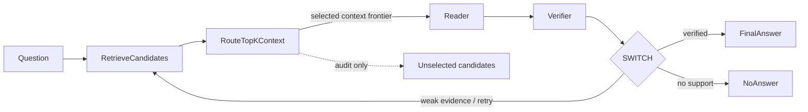

# Context Routing / PaperServe in ResearchFS

Context routing is a dependency-free pattern for deciding which evidence a reader is allowed to see. In this checkout, the implementation belongs to `researchfs.context` rather than a separate `loopgraph` package: ResearchFS is the package that carries local paper memory and bounded retrieval utilities here.

## One frontier principle

LoopGraph-style workflow routing has an **activation frontier**: at any point in a graph, only a bounded set of nodes should be active next. PaperServe applies the same principle to evidence with a **context frontier**: at any point in an answer workflow, only a bounded set of retrieved papers should reach the reader.

The two frontiers answer the same engineering question: what is allowed to cross the boundary into the expensive or high-risk next step?



- The activation frontier controls which workflow nodes run.
- The context frontier controls which evidence nodes are visible to the reader.
- Both are bounded, deterministic, auditable cuts through a larger graph.

## Bad pattern: retrieve everything, paste everything

```python
candidates = retrieve_papers(question)
answer = reader(question, context=candidates)  # bad: hard negatives and distractors included
```

This makes the reader responsible for routing, ranking, filtering, and answering at the same time. It increases attention dilution: even when the gold paper is present, hard negatives and distractors compete for the same reader attention budget. If the answer is wrong, it is difficult to tell whether retrieval failed, selection failed, or the reader ignored the right evidence.

## Good pattern: route a selected evidence frontier

```python
from researchfs.context import ContextBudget, route_top_k_context

candidates = retrieve_papers(question)
selection = route_top_k_context(
    candidates,
    k=2,
    budget=ContextBudget(max_items=2, max_tokens=800, overflow_policy="drop_lowest_score"),
)
answer = reader(question, context=selection.selected)
verification = verifier(answer, selected_context=selection.selected)
```

The reader receives selected context only. The full candidate set remains available for audit, metrics, and recovery decisions, but it is not passed into the reader prompt. If verification reports that required evidence is missing, the workflow can retrieve again and route a new frontier.

## First-class routed ask loop

Applications that want the full local product loop can call the routed ask
workflow instead of hand-wiring retrieval, routing, reading, verification,
recovery, and audit logging:

```python
from researchfs.ask import run_routed_ask

result = run_routed_ask(
    "clip matrix optimizer risk",
    conn=conn,
    max_papers=3,
    k=2,
    max_reader_tokens=1200,
    max_retries=1,
    include_scores=True,
    log=True,
)
```

The matching CLI command is:

```bash
uv run python -m researchfs.memory ask \
  --query "clip matrix optimizer risk" \
  --route-context \
  --verify \
  --recover \
  --max-papers 3 \
  --k 2 \
  --max-reader-tokens 1200 \
  --log
```

`run_routed_ask(...)` calls `get_research_brief(...)`, converts the brief to
`ContextCandidate` records, routes a selected frontier with
`route_top_k_context(...)`, passes only that selected frontier to the reader,
verifies selected-frontier citations, and retries by expanding `max_papers` when
verification says the miss is recoverable. CLI and local API defaults use the
deterministic local extractive `default_reader(...)` plus
`citation_verifier(...)`; they do not require a provider SDK, model package, or
GPU.

NanoChat and its model/GPU dependencies live in the separately managed
`benchmarks/nanochat` project and are excluded from the core install.

Applications that already own a model-backed reader or stricter verifier can
inject callables in process instead of exposing a network plugin system. The
supported injection surfaces are `ResearchFSSession.routed_ask(reader=...,
verifier=...)`, `ResearchFSClient.ask(reader=..., verifier=...)`, and
`ResearchFSLabAPI(reader_fn=..., verifier_fn=...)`. These callables receive the
same selected `ContextCandidate` list that the deterministic defaults receive;
rejected candidates stay audit-only.

## ResearchFS paper-memory adapter

Use the opt-in adapter when retrieval already returned bounded ResearchFS paper
memory cards. The candidate id is the paper id string, so later citations can
line up with ResearchFS paper ids.

The helpers are available from `researchfs.context` and as lazy top-level
`researchfs` exports for callers that already import the package facade.

```python
from researchfs.context import (
    ContextBudget,
    log_context_routing_audit,
    paper_memory_to_context_candidate,
    research_brief_to_context_candidates,
    route_top_k_context,
)
from researchfs.retrieve import get_paper_memory, get_research_brief

card = get_paper_memory(42, conn=conn, max_chars=2_000)
candidate = paper_memory_to_context_candidate(card)

brief = get_research_brief("Which method should we reuse?", conn=conn, max_papers=3)
candidates = research_brief_to_context_candidates(
    brief,
    conn=conn,
    per_paper_max_chars=2_000,
)
selection = route_top_k_context(
    candidates,
    k=2,
    budget=ContextBudget(max_items=2, max_tokens=800),
)

event_id = log_context_routing_audit(
    "Which method should we reuse?",
    selection,
    conn=conn,
)
```

`log_context_routing_audit(...)` writes a bounded, deterministic JSON audit
payload through the existing `retrieval_events` path with event type
`context_routing_audit`. It does not change retrieval defaults, API responses,
or the database schema; selected method ids from candidate metadata are linked
through the existing retrieval logging helper when available.

## Attention dilution and system-level mitigation

Attention dilution is the practical failure mode where irrelevant or near-miss evidence weakens the reader's focus on the paper that actually supports the answer. Context routing is a system-level mitigation:

1. Keep retrieval broad enough to find plausible evidence.
2. Route a narrow selected frontier before reading.
3. Track all candidates separately from selected reader context.
4. Verify that the answer is supported by selected citations.
5. Retry retrieval when the verifier reports missing required evidence.

This does not require model changes. It is an orchestration and evidence-budgeting pattern that can be used with local heuristics, tests, or any external reader the application already owns.

## Metrics

The public `researchfs.context` metrics are simple stdlib helpers for benchmark
accounting. `false_stop_rate(...)` reports the fraction of attempts that stopped
without enough evidence; inputs may be booleans or dict/object records with
fields such as `false_stop` or `stopped_without_enough_evidence`. Use it beside
supported-answer and recovery metrics to detect workflows that quit before the
context frontier contains the required citations.

Public metric helpers: `gold_recall_at_k(...)`, `citation_precision(...)`,
`citation_recall(...)`, `citation_f1(...)`, `supported_answer_rate(...)`,
`context_efficiency(...)`, `recovery_success(...)`, `recovery_rate(...)`, and
`false_stop_rate(...)`.

## Non-goals in this checkout

ResearchFS/LoopGraph in this checkout does not implement SSMax, custom attention kernels, vector DBs, provider integrations, RL training, GPU dependencies, or model dependencies.

More explicitly, this pattern is not:

- a vector database or embedding index;
- an LLM provider integration;
- a scheduler or NodeKind execution semantics change;
- a GPU kernel, GPU dependency, model dependency, custom attention implementation, or SSMax substitute;
- a reinforcement-learning trainer;
- a claim that longer context windows alone solve evidence selection.

The `examples/paperserve_env.py` file is only a small deterministic environment shape that an external trainer could call. It does not train a policy. The `examples/context_routing_papers.py` file is only a deterministic paper-routing workflow that demonstrates selected context, verifier feedback, and recovery.

## Benchmark fixture intent

Fixtures under `tests/fixtures/context_routing/` separate the retrieval set from the reader frontier. They include gold papers, hard negatives, distractors, budgets, required citations, and expected answer points so tests can measure whether routing preserves support without exposing all retrieved candidates to the reader.

## Benchmark runner

Run the fixture benchmark with:

```bash
uv run python examples/context_routing_benchmark.py --compact
```

The runner loads `tests/fixtures/context_routing/*.json`, converts fixture papers
to `ContextCandidate` objects, routes them with `route_top_k_context`, and
simulates a reader that only answers when the selected context contains the
required citations. The loop-recovery fixture starts with attempt-1 candidates,
then routes all candidates on attempt 2 if the first attempt lacks support.

Per-fixture output includes `fixture_id`, `selected_ids`, `selected_tokens`,
`rejected_ids`, `status`, `citations`, `supported`, `gold_recall_at_k`,
`citation_precision`, `citation_recall`, `citation_f1`, `context_efficiency`,
`recovered`, and `false_stop`. Aggregate output includes `task_count`,
`supported_answer_rate`, `average_selected_papers`, `average_selected_tokens`,
`gold_recall_at_k`, `citation_precision`, `citation_recall`, `citation_f1`,
`context_efficiency`, `recovery_rate`, and `false_stop_rate`.

## Opt-in ResearchFS adapter and audit logging

Context routing does not change `get_research_brief(...)`, `get_paper_memory(...)`,
or API retrieval responses by default. Existing ResearchFS callers continue to
receive the same bounded research brief and paper-memory payloads unless they
explicitly opt in to the adapter helpers.

Use `paper_memory_to_context_candidate(...)` when an application already has one
`get_paper_memory(...)` result:

```python
from researchfs.context import paper_memory_to_context_candidate

card = get_paper_memory(paper_id, conn=conn, max_chars=2000)
candidate = paper_memory_to_context_candidate(card)
```

Use `research_brief_to_context_candidates(...)` when an application has a
`get_research_brief(...)` result and wants one routed candidate per referenced
paper:

```python
from researchfs.context import (
    ContextBudget,
    log_context_routing_audit,
    research_brief_to_context_candidates,
    route_top_k_context,
)

brief = get_research_brief("context routing attention dilution", conn=conn)
candidates = research_brief_to_context_candidates(
    brief,
    conn=conn,
    per_paper_max_chars=2000,
)
selection = route_top_k_context(
    candidates,
    k=2,
    budget=ContextBudget(max_items=2, max_tokens=1200),
)
event_id = log_context_routing_audit(
    brief["query"],
    selection,
    conn=conn,
)
```

`log_context_routing_audit(...)` is schema-free. It reuses
`log_retrieval_event(...)` with `event_type="context_routing_audit"` and stores a
bounded JSON audit payload in `retrieved_content`, including selected/rejected
candidate IDs and token counts. Selected candidate `method_ids` are linked
through the existing `retrieved_methods` table when present in candidate
metadata.
