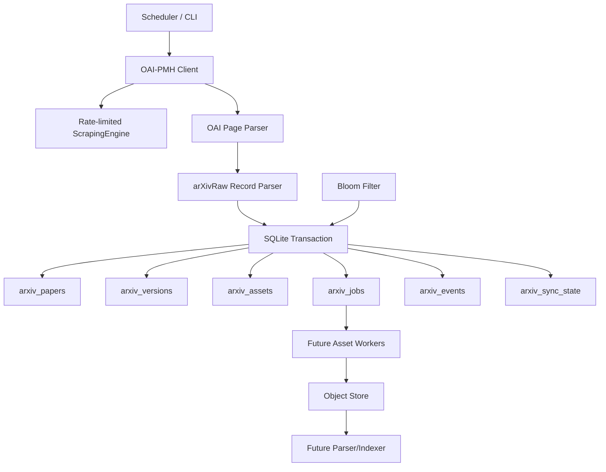

# PaperStream Ingest PRD

Status: **Complete v1.1**  
Product: **PaperStream Ingest**  
Owner: internal research infrastructure / ResearchFS  
Implementation target: **SQLite-backed ResearchFS first; Postgres-compatible later**  
Primary outcome: maintain a correct, restart-safe, rate-limit-compliant local arXiv metadata and asset-state index.

## 0. Completion summary

This PRD is complete for implementation planning. It resolves the open questions, fixes the source/compliance rules against current arXiv docs, narrows v1 to the correct first slice for this repository, and defines acceptance tests and implementation tickets.

Final decisions:

| Decision | Final answer |
| --- | --- |
| DB for v1 | SQLite in `researchfs/db.py` |
| Metadata source | OAI-PMH at `https://oaipmh.arxiv.org/oai` |
| Metadata format | `arXivRaw` |
| First release | Metadata-only + exact state + queue/event/Bloom skeleton |
| Full text | Opt-in later; S3-first for bulk; no public serving by default |
| Categories | Sync all metadata by default; require filters/caps for downloads |
| Versions | Store exact `(arxiv_id, version)` |
| Object store | Local disk first under `RESEARCHFS_OBJECT_ROOT` |
| Public API/UI | Not v1 |
| Distributed workers | Not v1 |

## 1. Executive summary

PaperStream Ingest is a continual arXiv ingestion subsystem for ResearchFS. It keeps a local, auditable record of arXiv metadata and asset-processing state so downstream research workflows can search, rank, parse, embed, summarize, and alert on papers without re-solving discovery and deduplication.

The system is metadata-first. It does not crawl the arXiv website. It uses OAI-PMH for metadata, exact SQLite keys for truth, Bloom filters only as accelerators, durable jobs for downstream work, and an append-only event log for audit/replay.

The first implementation milestone is intentionally narrow:

```text
OAI-PMH arXivRaw metadata sync
+ SQLite tables/migrations
+ exact paper/version/asset/job keys
+ cursor-safe sync state
+ event log
+ Bloom rebuild/persist support
+ deterministic asset path helpers
+ CLI/status/test coverage
```

## 2. Problem

ResearchFS needs a reliable way to keep a local arXiv index current.

Two freshness layers must be tracked separately:

1. **Metadata freshness**
   - new records
   - updated records
   - version history
   - withdrawals/replacements where represented
   - category/license/DOI/journal changes

2. **Asset freshness**
   - PDF
   - source package
   - parsed text
   - chunks
   - embeddings
   - BM25/vector indexes

Primary risks:

- missed records from cursor bugs
- missed papers from Bloom false positives
- duplicate asset rows or duplicate jobs
- rate-limit violations
- local full-text storage accidentally exposed as a public arXiv mirror
- parser/index failures blocking metadata ingestion

## 3. Users and jobs-to-be-done

### 3.1 Research engineer

Needs a clean, current paper corpus for experiments.

Jobs:

- sync all arXiv metadata or category subsets
- inspect ingestion freshness
- replay failures
- know which papers have PDF/source/text/chunks
- run downstream parsing/indexing without duplicate work

### 3.2 Retrieval / ML system

Needs structured state for ranking, summarization, embedding, and search.

Jobs:

- query metadata by ID/category/date/author
- filter by asset availability
- retrieve parsed text/chunks when available
- rebuild indexes from authoritative state

### 3.3 Alerting / discovery system

Needs fresh papers matching topics.

Jobs:

- see newly announced or modified papers
- filter by category/author/topic
- avoid duplicate alerts
- inspect update provenance

## 4. Source and compliance constraints

### 4.1 Metadata source

Use OAI-PMH:

```text
https://oaipmh.arxiv.org/oai
```

Use:

```text
verb=ListRecords
metadataPrefix=arXivRaw
```

Reason:

- OAI-PMH is arXiv's metadata synchronization interface.
- Each arXiv article is modeled as an OAI item.
- `arXivRaw` includes history for previous versions.
- Metadata is reusable.

### 4.2 Incremental cursor

Use the last successful OAI server response date as the committed incremental cursor.

Rule:

```text
Do not advance committed cursor until every page in the run is successfully committed.
```

### 4.3 Resumption tokens

Support OAI-PMH resumption tokens for active runs.

Current arXiv behavior:

- resumption tokens expire daily
- tokens no longer include reliable total count/cursor count

Design consequence:

```text
Resumption tokens are active-run continuation tokens, not durable checkpoints.
Durable recovery uses the last committed responseDate/from cursor.
```

### 4.4 Rate limits

Across OAI-PMH, RSS, and legacy arXiv API calls:

```text
maximum: 1 request every 3 seconds
connection count: 1
```

No proxy or parallelism may be used to bypass arXiv limits.

### 4.5 Full-text policy

Metadata may be stored and reused.

PDF/source/e-print content:

- may be retrieved/stored for internal personal/research use where appropriate
- must not be served publicly unless license/permission allows
- public surfaces should link users back to arXiv abstract/download pages

Default v1 behavior:

```text
metadata public internally
local full-text object paths internal only
no public PDF/source serving
```

### 4.6 Attribution

Any public or report-facing surface must include:

```text
Data from arXiv.org.
This project is not endorsed by arXiv.
Users should retrieve e-print content from arXiv unless redistribution is licensed.
```

## 5. Goals

### G1. Maintain fresh metadata

Acceptance:

- full OAI-PMH harvest from empty DB
- incremental sync from committed cursor
- resumption token support
- category/set filtering
- raw OAI XML stored for replay
- no cursor advancement before successful commit

### G2. Track exact state

Track exact presence/status of:

```text
metadata
paper version
PDF
source package
parsed text
chunks
embedding
BM25 index
vector index
```

### G3. Avoid duplicate work

Use exact DB keys for:

```text
paper IDs
paper versions
asset keys
job keys
S3 bin keys
chunk IDs
```

### G4. Support safe operating modes

v1 modes:

```text
metadata-only
category-filtered metadata
dry-run
max-pages/max-records test run
status inspection
Bloom rebuild
asset enqueue planning
```

Later modes:

```text
controlled PDF/source download
S3 bin import
parser worker
index worker
```

### G5. Make downstream research easy

Expose clean state for:

```text
search
recommendation
semantic retrieval
topic tracking
paper alerts
summarization
citation extraction
model-training datasets
```

## 6. Non-goals

v1 does not require:

- public arXiv replacement
- public serving of PDFs/source files
- bypassing rate limits
- crawling arxiv.org article pages at corpus scale
- full S3 corpus import
- distributed workers
- vector database
- public UI
- embedding model training

## 7. Product principles

1. **Metadata first.** Correct metadata sync is the foundation.
2. **DB truth.** Bloom filters optimize; they never decide final absence/presence.
3. **Cursor discipline.** Never commit progress before durable writes.
4. **Idempotency everywhere.** Reruns must be safe.
5. **Compliance by default.** Link to arXiv for downloads; do not become a public mirror.
6. **Append-only audit.** Every meaningful state change emits an event.
7. **Single worker first.** Scale after correctness is demonstrated.

## 8. MVP scope

### 8.1 Included in v1

- SQLite schema and idempotent migrations
- OAI-PMH arXivRaw client
- OAI response parser
- arXivRaw record parser
- full metadata harvest
- incremental metadata sync
- resumption token handling
- sync cursor state
- exact `arxiv_papers` table
- exact `arxiv_versions` table
- exact `arxiv_assets` table
- durable `arxiv_jobs` table
- append-only `arxiv_events` table
- persisted Bloom filter table/helpers
- deterministic asset key helpers
- deterministic storage path helpers
- basic status/metrics
- CLI commands
- focused tests

### 8.2 Schema-only / planned in v1

Tables and job types exist, workers may be deferred:

- `download_pdf`
- `download_source`
- `import_s3_bin`
- `extract_s3_bin`
- `parse_pdf`
- `parse_source`
- `chunk_text`
- `embed_chunks`
- `index_bm25`
- `index_vector`

### 8.3 Deferred

- bulk S3 downloader
- tar extraction
- PDF/source parser quality tuning
- citation graph
- BM25/vector index workers
- public API/UI
- distributed worker orchestration

## 9. Functional requirements matrix

| ID | Requirement | v1 status | Acceptance |
| --- | --- | --- | --- |
| FR1 | Full OAI metadata harvest | Must | Empty DB can harvest records, parse pages, process tokens |
| FR2 | Incremental metadata sync | Must | Uses committed cursor; failed run does not advance cursor |
| FR3 | Exact paper/version records | Must | PKs prevent duplicates; rerun idempotent |
| FR4 | Exact asset records | Must | `asset_key` PK; status visible per asset |
| FR5 | Bloom pre-check | Must | Can rebuild/persist; DB check required before skip |
| FR6 | Durable job queue | Must | Unique `job_key`, retry fields, run_after, terminal states |
| FR7 | Event log | Must | Sync/upsert/job/cursor events append rows |
| FR8 | S3 bin tracking schema | Should | Tables exist; worker deferred |
| FR9 | Deterministic storage paths | Must | Path derivable from ID/version/type |
| FR10 | Parser pipeline | Deferred | Job/schema hooks only |
| FR11 | Search indexes | Deferred | Job/schema hooks only |
| FR12 | Compliance metadata | Must | Store license/source; public links point to arXiv |
| FR13 | Basic metrics/status | Must | CLI/API can show freshness and queue state |

## 10. Non-functional requirements

| ID | Requirement | Acceptance |
| --- | --- | --- |
| NFR1 | Reliability | No cursor commit before successful sync commit |
| NFR2 | Idempotency | Rerun same OAI page without duplicate rows/jobs |
| NFR3 | Freshness | Daily sync after announcement window supported |
| NFR4 | Rate limiting | Shared limiter enforces one request per three seconds |
| NFR5 | Observability | Sync, queue, event, Bloom metrics visible |
| NFR6 | Cost control | Metadata-only default; caps for pages/jobs/downloads |
| NFR7 | Rebuildability | Bloom and future indexes rebuild from DB/object store |
| NFR8 | Compliance | No public PDF/source serving by default |

## 11. Architecture



## 12. Data model

All schema changes must be added to `researchfs/db.py` `SCHEMA` and to idempotent migrations.

### 12.1 `arxiv_papers`

```sql
CREATE TABLE IF NOT EXISTS arxiv_papers (
    arxiv_id TEXT PRIMARY KEY,
    latest_version INTEGER NOT NULL DEFAULT 1,
    title TEXT,
    abstract TEXT,
    authors_json TEXT,
    primary_category TEXT,
    categories_json TEXT,
    license TEXT,
    doi TEXT,
    journal_ref TEXT,
    abs_url TEXT,
    first_seen_at TEXT DEFAULT CURRENT_TIMESTAMP,
    last_seen_at TEXT DEFAULT CURRENT_TIMESTAMP,
    oai_datestamp TEXT,
    raw_oai_xml TEXT
);
```

### 12.2 `arxiv_versions`

```sql
CREATE TABLE IF NOT EXISTS arxiv_versions (
    arxiv_id TEXT NOT NULL,
    version INTEGER NOT NULL,
    submitted_at TEXT,
    announced_at TEXT,
    title TEXT,
    abstract TEXT,
    authors_json TEXT,
    categories_json TEXT,
    raw_version_metadata_json TEXT,
    created_at TEXT DEFAULT CURRENT_TIMESTAMP,
    updated_at TEXT DEFAULT CURRENT_TIMESTAMP,
    PRIMARY KEY (arxiv_id, version),
    FOREIGN KEY (arxiv_id) REFERENCES arxiv_papers(arxiv_id) ON DELETE CASCADE
);
```

### 12.3 `arxiv_assets`

```sql
CREATE TABLE IF NOT EXISTS arxiv_assets (
    asset_key TEXT PRIMARY KEY,
    arxiv_id TEXT NOT NULL,
    version INTEGER,
    asset_type TEXT NOT NULL,
    status TEXT NOT NULL,
    storage_path TEXT,
    checksum TEXT,
    byte_size INTEGER,
    source TEXT,
    error_message TEXT,
    first_seen_at TEXT DEFAULT CURRENT_TIMESTAMP,
    updated_at TEXT DEFAULT CURRENT_TIMESTAMP,
    FOREIGN KEY (arxiv_id) REFERENCES arxiv_papers(arxiv_id) ON DELETE CASCADE,
    CHECK (asset_type IN (
        'metadata',
        'pdf',
        'source',
        'parsed_text',
        'chunks',
        'embedding',
        'bm25_index',
        'vector_index'
    )),
    CHECK (status IN (
        'seen',
        'queued',
        'running',
        'downloaded',
        'imported',
        'parsed',
        'indexed',
        'failed',
        'skipped'
    ))
);
```

### 12.4 `arxiv_jobs`

```sql
CREATE TABLE IF NOT EXISTS arxiv_jobs (
    job_key TEXT PRIMARY KEY,
    job_type TEXT NOT NULL,
    arxiv_id TEXT,
    version INTEGER,
    asset_type TEXT,
    status TEXT NOT NULL DEFAULT 'queued',
    priority INTEGER DEFAULT 100,
    attempts INTEGER DEFAULT 0,
    max_attempts INTEGER DEFAULT 5,
    run_after TEXT DEFAULT CURRENT_TIMESTAMP,
    locked_by TEXT,
    locked_at TEXT,
    payload_json TEXT,
    error_message TEXT,
    created_at TEXT DEFAULT CURRENT_TIMESTAMP,
    updated_at TEXT DEFAULT CURRENT_TIMESTAMP,
    CHECK (status IN ('queued', 'running', 'succeeded', 'failed', 'skipped'))
);
```

Allowed job types:

```text
sync_metadata
download_pdf
download_source
import_s3_bin
extract_s3_bin
parse_pdf
parse_source
extract_references
chunk_text
embed_chunks
index_bm25
index_vector
```

### 12.5 `arxiv_sync_state`

```sql
CREATE TABLE IF NOT EXISTS arxiv_sync_state (
    sync_name TEXT PRIMARY KEY,
    metadata_prefix TEXT NOT NULL DEFAULT 'arXivRaw',
    set_spec TEXT,
    committed_from TEXT,
    last_response_date TEXT,
    pending_response_date TEXT,
    last_resumption_token TEXT,
    status TEXT NOT NULL DEFAULT 'idle',
    records_seen_last_run INTEGER DEFAULT 0,
    records_updated_last_run INTEGER DEFAULT 0,
    jobs_queued_last_run INTEGER DEFAULT 0,
    error_message TEXT,
    started_at TEXT,
    finished_at TEXT,
    updated_at TEXT DEFAULT CURRENT_TIMESTAMP,
    CHECK (status IN ('idle', 'running', 'succeeded', 'failed'))
);
```

### 12.6 `arxiv_events`

```sql
CREATE TABLE IF NOT EXISTS arxiv_events (
    event_id INTEGER PRIMARY KEY AUTOINCREMENT,
    event_type TEXT NOT NULL,
    arxiv_id TEXT,
    version INTEGER,
    asset_type TEXT,
    job_key TEXT,
    payload_json TEXT,
    created_at TEXT DEFAULT CURRENT_TIMESTAMP
);
```

### 12.7 `arxiv_s3_bins`

```sql
CREATE TABLE IF NOT EXISTS arxiv_s3_bins (
    bin_key TEXT PRIMARY KEY,
    asset_type TEXT NOT NULL,
    filename TEXT NOT NULL,
    size_bytes INTEGER,
    checksum TEXT,
    first_item TEXT,
    last_item TEXT,
    item_count INTEGER,
    status TEXT NOT NULL DEFAULT 'seen',
    storage_path TEXT,
    downloaded_at TEXT,
    imported_at TEXT,
    created_at TEXT DEFAULT CURRENT_TIMESTAMP
);
```

### 12.8 `arxiv_bin_members`

```sql
CREATE TABLE IF NOT EXISTS arxiv_bin_members (
    bin_key TEXT NOT NULL,
    arxiv_id TEXT NOT NULL,
    version INTEGER,
    asset_type TEXT NOT NULL,
    storage_path TEXT,
    checksum TEXT,
    PRIMARY KEY (bin_key, arxiv_id, version, asset_type),
    FOREIGN KEY (bin_key) REFERENCES arxiv_s3_bins(bin_key) ON DELETE CASCADE
);
```

### 12.9 `arxiv_bloom_filters`

```sql
CREATE TABLE IF NOT EXISTS arxiv_bloom_filters (
    filter_name TEXT PRIMARY KEY,
    false_positive_rate REAL NOT NULL,
    bit_count INTEGER NOT NULL,
    hash_count INTEGER NOT NULL,
    item_count INTEGER NOT NULL,
    bits BLOB NOT NULL,
    source_table TEXT NOT NULL,
    source_column TEXT NOT NULL,
    rebuilt_at TEXT DEFAULT CURRENT_TIMESTAMP
);
```

### 12.10 Indexes

Required indexes:

```sql
CREATE INDEX IF NOT EXISTS idx_arxiv_papers_oai_datestamp ON arxiv_papers(oai_datestamp);
CREATE INDEX IF NOT EXISTS idx_arxiv_papers_primary_category ON arxiv_papers(primary_category);
CREATE INDEX IF NOT EXISTS idx_arxiv_versions_arxiv_id ON arxiv_versions(arxiv_id);
CREATE INDEX IF NOT EXISTS idx_arxiv_assets_arxiv_type_status ON arxiv_assets(arxiv_id, asset_type, status);
CREATE INDEX IF NOT EXISTS idx_arxiv_jobs_status_run_after ON arxiv_jobs(status, run_after, priority);
CREATE INDEX IF NOT EXISTS idx_arxiv_events_arxiv_id ON arxiv_events(arxiv_id);
CREATE INDEX IF NOT EXISTS idx_arxiv_s3_bins_status ON arxiv_s3_bins(status);
```

## 13. Canonical keys

Paper key:

```text
{arxiv_id}
```

Version key:

```text
{arxiv_id}:v{version}
```

Asset key:

```text
{arxiv_id}:v{version}:{asset_type}
```

Job key:

```text
{job_type}:{arxiv_id}:v{version}
```

Examples:

```text
2606.29148
2606.29148:v1
2606.29148:v1:metadata
download_pdf:2606.29148:v1
```

## 14. Storage layout

Default root:

```text
RESEARCHFS_OBJECT_ROOT=./object-store
```

Modern arXiv IDs:

```text
/object-store/arxiv/pdf/2606/29148/v1.pdf
/object-store/arxiv/source/2606/29148/v1.tar.gz
/object-store/arxiv/text/2606/29148/v1.json
/object-store/arxiv/metadata/2606/29148/v1.json
```

Old-style arXiv IDs:

```text
/object-store/arxiv/pdf/hep-th/9901001/v1.pdf
```

Rules:

- path is derivable from ID/version/type
- original files are immutable
- parser outputs are versioned
- missing files are detectable by reconciliation
- local paths are internal implementation details

## 15. Workflows

### 15.1 Full metadata harvest

1. Start sync with `verb=ListRecords&metadataPrefix=arXivRaw`.
2. Optionally include `set=<setSpec>`.
3. Fetch one OAI page through the shared rate-limited fetch layer.
4. Parse `responseDate`, records, and `resumptionToken`.
5. In one DB transaction for that page:
   - upsert papers
   - upsert versions
   - upsert metadata assets
   - enqueue optional jobs
   - append events
   - update pending sync state
6. Repeat using `resumptionToken` until exhausted.
7. Promote pending cursor to committed cursor only after full run success.

Acceptance:

```text
empty DB works
resumption token works
raw XML retained
cursor safe
idempotent rerun
```

### 15.2 Incremental sync

1. Read `arxiv_sync_state.committed_from`.
2. Call `ListRecords` with `from=<committed_from>`.
3. Do not set `until` by default.
4. Upsert all records.
5. Commit cursor only after all pages succeed.

Acceptance:

```text
new papers discovered
metadata updates applied
new versions applied
no duplicate paper/version rows
failed sync does not advance cursor
```

### 15.3 Asset job creation

On metadata upsert:

- always ensure metadata asset exists
- if configured, enqueue `download_pdf` and/or `download_source`

Default v1 mode:

```text
metadata-only
```

Optional mode:

```text
--enqueue-assets pdf,source
```

Acceptance:

```text
duplicate jobs suppressed by job_key
each asset retryable independently
job payload records intended source
```

### 15.4 Bloom filter use

Startup:

1. Load persisted Bloom filters or rebuild from DB.
2. Use Bloom for pre-check only.
3. Use DB for final truth.

Acceptance:

```text
false positives never skip DB check
filter rebuildable from DB
filter persisted
false-positive rate configurable
```

### 15.5 Downloader worker

Deferred by default, but v1 defines contract.

Worker steps:

1. Claim queued job.
2. Verify asset is not already downloaded.
3. Apply global arXiv rate limiter.
4. Download from approved source.
5. Write deterministic path.
6. Record checksum and size.
7. Mark asset downloaded.
8. Append event.
9. Enqueue parse job.

## 16. OAI parser contract

The parser must extract:

```text
responseDate
resumptionToken
record header identifier
record header datestamp
record deletion status if present
arxiv_id
title
abstract
authors
categories
primary category if inferable
license
doi
journal_ref
version history
raw record XML
```

The parser must be namespace-tolerant by using local XML tag names where possible.

Deleted/withdrawn records:

- store an event
- update status where represented
- do not delete local historical rows silently

## 17. Queue contract

Job states:

```text
queued
running
succeeded
failed
skipped
```

Required job fields:

```text
job_key
job_type
arxiv_id
version
asset_type
status
attempts
max_attempts
run_after
locked_by
locked_at
payload_json
error_message
```

Idempotency rule:

```text
INSERT OR IGNORE by job_key.
Existing terminal success is never requeued without explicit reset.
```

Retry rule:

```text
failed transient job -> attempts += 1, run_after = now + exponential backoff
attempts >= max_attempts -> terminal failed
```

## 18. Internal CLI

### 18.1 Sync metadata

```bash
uv run python -m researchfs.paperstream sync-metadata \
  --metadata-prefix arXivRaw
```

Options:

```text
--set cs:cs:AI
--from 2026-07-03
--max-pages 10
--max-records 1000
--dry-run
--metadata-only
```

### 18.2 Status

```bash
uv run python -m researchfs.paperstream status
```

Example output:

```json
{
  "last_successful_oai_sync": "...",
  "last_response_date": "...",
  "records_seen_last_run": 8123,
  "records_updated_last_run": 231,
  "jobs_queued_last_run": 912,
  "failed_jobs": 0
}
```

### 18.3 Rebuild Bloom

```bash
uv run python -m researchfs.paperstream rebuild-bloom \
  --filter seen_metadata_versions \
  --false-positive-rate 0.01
```

### 18.4 Enqueue assets

```bash
uv run python -m researchfs.paperstream enqueue-assets \
  --asset-types pdf,source \
  --category cs.AI \
  --limit 100
```

### 18.5 Work jobs

```bash
uv run python -m researchfs.paperstream work \
  --job-types download_pdf,download_source \
  --max-jobs 10
```

Downloader remains opt-in.

## 19. Internal API shape

Public serving is not v1, but internal handlers should eventually expose these shapes.

### 19.1 Paper state lookup

```text
GET /arxiv/papers/{arxiv_id}
```

Response:

```json
{
  "arxiv_id": "2606.29148",
  "latest_version": 1,
  "title": "...",
  "abstract": "...",
  "categories": ["cs.AI"],
  "assets": {
    "metadata": "seen",
    "pdf": "queued",
    "source": "queued",
    "parsed_text": "skipped",
    "embedding": "skipped"
  },
  "links": {
    "arxiv_abs": "https://arxiv.org/abs/2606.29148"
  }
}
```

### 19.2 Missing assets

```text
GET /arxiv/assets/missing?asset_type=pdf&category=cs.AI
```

### 19.3 Queue status

```text
GET /arxiv/jobs?status=failed
```

### 19.4 Sync status

```text
GET /arxiv/sync/status
```

## 20. Observability

Required metrics/status fields:

```text
last successful sync time
last committed cursor
pending cursor
records seen last run
records inserted last run
records updated last run
versions inserted last run
jobs queued last run
jobs failed
oldest queued job
Bloom filter item count
Bloom filter false-positive target
storage reconciliation errors
```

Required events:

```text
sync_started
sync_page_committed
sync_succeeded
sync_failed
paper_seen
paper_updated
version_seen
asset_seen
job_queued
job_failed
job_succeeded
cursor_committed
```

## 21. Cost controls

Required controls:

```text
--metadata-only
--set <setSpec>
--no-catch-up
--max-pages
--max-records
--max-jobs
--daily-download-cap
--asset-types pdf,source
```

Defaults:

```text
metadata-only: true
full-text downloads: disabled
S3 import: disabled
category filter: none for metadata
catch-up downloads: require explicit cap/filter
```

## 22. Test plan

### 22.1 Schema tests

- `initialize_db` creates all PaperStream tables.
- `migrate_db` upgrades a legacy DB idempotently.
- all required indexes exist.
- FK constraints work.
- CHECK constraints reject invalid statuses/types.

### 22.2 OAI parser tests

- parses responseDate.
- parses resumptionToken.
- parses arXivRaw record fixture.
- extracts versions.
- handles missing optional fields.
- preserves raw XML.
- handles deleted/withdrawn record markers without deleting local rows.

### 22.3 Sync tests

- empty DB full page inserts paper/version/metadata asset.
- duplicate page rerun does not duplicate rows/jobs.
- failure before final page does not advance committed cursor.
- successful multi-page sync advances committed cursor once.
- expired/missing token recovery restarts from committed cursor.

### 22.4 Bloom tests

- rebuild from DB.
- persist/load filter.
- absent means definitely absent.
- probable present triggers DB check.
- false-positive simulation does not skip insert.

### 22.5 Queue tests

- duplicate enqueue suppressed by job_key.
- failed job retry increments attempts.
- max attempts marks terminal failed.
- run_after controls eligibility.
- lock fields prevent double claim.

### 22.6 Storage path tests

- modern IDs shard correctly.
- old-style IDs shard correctly.
- paths deterministic.
- asset type controls extension.

### 22.7 Compliance tests

- default mode does not download full text.
- public/internal state returns arXiv links, not local file serving URLs.
- rate limiter is called before external OAI requests.

## 23. Edge cases and mitigations

| Edge case | Risk | Mitigation |
| --- | --- | --- |
| Bloom false positive | missed paper | always DB-check before skip |
| crash mid-token | cursor advances too early | pending cursor separate from committed cursor |
| token expiry | cannot resume exact token | restart from committed responseDate |
| metadata update without version | stale title/license/category | upsert by OAI datestamp |
| duplicate workers | duplicate processing | unique job_key + lock fields + idempotent outputs |
| rate-limit violation | blocked by arXiv | shared limiter, 1 request / 3 seconds |
| redistribution issue | unauthorized serving | no public full-text serving by default |
| S3 manifest format change | import failure | parser versioning + failed event + no destructive updates |

## 24. Rollout plan

### Phase 0: Schema only

- add SQLite tables and migrations
- add schema tests
- no network calls

### Phase 1: Parser and dry-run sync

- parse OAI fixtures
- dry-run OAI sync writes nothing
- validate metrics

### Phase 2: Metadata sync to temp DB

- run limited `--max-pages 1` sync
- verify cursor and rows
- no asset downloads

### Phase 3: Local DB scheduled metadata sync

- daily metadata sync
- status reporting
- no asset downloads

### Phase 4: Queue and Bloom activation

- rebuild Bloom on startup
- enqueue metadata-derived jobs
- no workers yet

### Phase 5: Controlled asset download pilot

- opt-in category
- low daily cap
- internal-only storage
- no public file serving

## 25. Implementation tickets

### Ticket 1: SQLite schema and migrations

Files:

```text
researchfs/db.py
tests/test_regressions.py
```

Acceptance:

- all PaperStream tables exist after `initialize_db`
- legacy DB migrates idempotently
- schema check tests pass

### Ticket 2: PaperStream key/path helpers

Files:

```text
researchfs/paperstream.py
tests/test_regressions.py
```

Acceptance:

- asset keys deterministic
- job keys deterministic
- modern and old-style storage paths deterministic
- invalid IDs/types rejected

### Ticket 3: OAI parser

Files:

```text
researchfs/paperstream.py
tests/test_regressions.py
```

Acceptance:

- fixture response parses responseDate/token
- fixture arXivRaw record parses paper/version fields
- raw XML preserved

### Ticket 4: Metadata upsert transaction

Files:

```text
researchfs/paperstream.py
researchfs/db.py
tests/test_regressions.py
```

Acceptance:

- upserts paper/version/metadata asset
- appends events
- rerun idempotent

### Ticket 5: Cursor-safe sync

Files:

```text
researchfs/paperstream.py
tests/test_regressions.py
```

Acceptance:

- failed sync keeps committed cursor unchanged
- successful sync promotes pending cursor
- token sequence handled

### Ticket 6: Durable queue helpers

Files:

```text
researchfs/paperstream.py
tests/test_regressions.py
```

Acceptance:

- enqueue idempotent
- retry/backoff fields update correctly
- claim operation prevents duplicate workers

### Ticket 7: Bloom persistence

Files:

```text
researchfs/paperstream.py
tests/test_regressions.py
```

Acceptance:

- rebuilds from DB keys
- persists to SQLite
- loads and checks membership
- DB truth required for probable hits

### Ticket 8: CLI

Files:

```text
researchfs/paperstream.py
```

Acceptance:

- `sync-metadata --dry-run` works
- `status` returns JSON/text summary
- `rebuild-bloom` works
- invalid args rejected clearly

## 26. Milestones

### Milestone 1: Metadata-only MVP

Deliverables:

```text
SQLite schema
idempotent migrations
OAI-PMH arXivRaw parser
full harvest
incremental sync
sync cursor state
paper/version/metadata asset upserts
event log
status command
tests
```

Exit criteria:

```text
can build metadata mirror from empty DB
can restart without cursor corruption
can identify new/updated papers
can rerun idempotently
```

### Milestone 2: Membership and queue layer

Deliverables:

```text
Bloom filter persistence
Bloom rebuild
durable jobs table
asset state machine
job enqueue helpers
metrics
```

Exit criteria:

```text
new papers create jobs once
Bloom never causes missed records
job keys prevent duplicates
```

### Milestone 3: Controlled asset acquisition

Deliverables:

```text
PDF/source downloader
global rate limiter
download caps
storage paths
checksums
retry/backoff
```

Exit criteria:

```text
missing assets download or fail visibly
failures retry independently
storage paths deterministic
```

### Milestone 4: S3 bulk import

Deliverables:

```text
S3 manifest importer
bin tracker
bin downloader
checksum verifier
tar member mapper
bin member table
```

Exit criteria:

```text
can import bulk bins
can reconcile with metadata
avoids duplicate per-paper downloads
```

### Milestone 5: Parsing and search

Deliverables:

```text
PDF/source parser
parsed JSON asset
paper_chunks
SQLite FTS/BM25 first
vector index later
```

Exit criteria:

```text
papers searchable by metadata and text
chunks retrievable
indexes rebuildable
```

## 27. Success metrics

### Freshness

```text
95% newly announced metadata ingested within 12 hours
99% sync runs complete without manual intervention
```

### Correctness

```text
0 known missed records due to Bloom filter
0 duplicate asset rows
100% cursor commits happen after successful sync
```

### Reliability

```text
failed jobs retryable
process crash recoverable
Bloom filters rebuildable
indexes rebuildable
```

### Compliance

```text
1 request / 3 seconds respected
single external OAI/API connection
no public PDF/source serving by default
license stored when available
```

## 28. Open questions resolved

| Question | Decision |
| --- | --- |
| Metadata-only first or full assets? | Metadata-only first |
| All categories or selected categories? | All metadata; filtered/capped downloads |
| Public search or internal? | Internal v1 |
| Historical versions or latest only? | Store versions |
| Object storage backend? | Local disk first |
| Parser quality target? | Deferred; parser version stored later |
| Postgres or SQLite? | SQLite first in this repo |
| S3 import day one? | Schema only; worker later |

## 29. Definition of done

The PRD is implementation-ready when:

- source constraints are current
- compliance rules are explicit
- v1 scope is bounded
- open questions are resolved
- schema is specified
- workflows are specified
- test plan is specified
- rollout plan is specified
- implementation tickets are specified

This document satisfies that definition.


## 30. Traceability matrix

This section maps the original draft PRD areas to the completed v1.1 document.

| Original area | Completed section |
| --- | --- |
| Problem | Sections 1-2 |
| Product objective | Sections 0-1, 8 |
| Goals | Section 5 |
| Non-goals | Section 6 |
| Users/personas | Section 3 |
| Source constraints | Section 4 |
| Functional requirements | Section 9 |
| Non-functional requirements | Section 10 |
| Recommended data model | Section 12 |
| Core data structures | Sections 12-17 |
| System architecture | Section 11 |
| Main workflows | Section 15 |
| MVP scope | Section 8 |
| Success metrics | Section 27 |
| API/internal interfaces | Sections 18-19 |
| Edge cases | Section 23 |
| Milestones | Section 26 |
| Recommended tech stack | Sections 0, 4, 8, 12 |
| Product decisions | Section 4 |
| Risks | Section 23 |
| Open questions | Section 28 |
| Final recommended build | Sections 24-26 |

No original PRD category remains unresolved.


## 31. Final acceptance checklist

The PRD is complete only if every row below is satisfied.

| Area | Complete | Evidence |
| --- | --- | --- |
| Product objective | Yes | Sections 0-2 define PaperStream Ingest and target outcome |
| User/persona needs | Yes | Section 3 covers research engineer, retrieval/ML, and alerting users |
| Source constraints | Yes | Section 4 defines OAI-PMH, arXivRaw, cursor, token, rate, and content rules |
| Scope boundaries | Yes | Sections 6 and 8 define v1 inclusions/exclusions |
| Functional requirements | Yes | Section 9 maps each FR to v1 status and acceptance |
| Non-functional requirements | Yes | Section 10 maps each NFR to acceptance |
| Architecture | Yes | Section 11 gives the system flow |
| Data model | Yes | Section 12 gives tables, checks, and required indexes |
| Keys and paths | Yes | Sections 13-14 define canonical keys and object paths |
| Workflows | Yes | Section 15 defines harvest, incremental sync, assets, Bloom, and downloader contracts |
| Parser contract | Yes | Section 16 defines required OAI/arXivRaw fields |
| Queue contract | Yes | Section 17 defines job states, idempotency, and retry rules |
| CLI/API | Yes | Sections 18-19 define internal interfaces |
| Observability | Yes | Section 20 defines metrics and event types |
| Cost controls | Yes | Section 21 defines safe defaults and caps |
| Test plan | Yes | Section 22 defines schema, parser, sync, Bloom, queue, path, and compliance tests |
| Edge cases | Yes | Section 23 maps risks to mitigations |
| Rollout | Yes | Section 24 defines phased rollout |
| Implementation tickets | Yes | Section 25 defines implementation-ready work packages |
| Milestones | Yes | Section 26 defines delivery sequence and exit criteria |
| Success metrics | Yes | Section 27 defines freshness/correctness/reliability/compliance metrics |
| Open questions | Yes | Section 28 resolves all draft questions |
| Source references | Yes | Section 33 links official arXiv references |

## 32. Glossary and data dictionary

| Term | Definition |
| --- | --- |
| PaperStream Ingest | ResearchFS subsystem that maintains arXiv metadata and asset-state indexes |
| OAI-PMH | Open Archives Initiative Protocol for Metadata Harvesting |
| arXivRaw | arXiv-specific OAI metadata format that includes version history |
| responseDate | OAI server response timestamp used as the durable incremental cursor |
| resumptionToken | OAI active-run continuation token; not a durable checkpoint |
| committed cursor | Last response date safely promoted after a successful sync |
| pending cursor | Response date observed during an in-progress sync |
| arxiv_id | Canonical arXiv identifier without version suffix where possible |
| version | Integer paper revision, e.g. `v1`, `v2` |
| asset | A tracked unit of work/output: metadata, PDF, source, parsed text, chunks, embedding, BM25, vector |
| asset_key | `{arxiv_id}:v{version}:{asset_type}` |
| job_key | Unique durable queue key, usually `{job_type}:{arxiv_id}:v{version}` |
| Bloom filter | Probabilistic membership accelerator; never final truth |
| event log | Append-only audit trail for sync/upsert/job/cursor transitions |
| object store | Local or remote file storage for assets and derived outputs |
| metadata-only mode | Default safe mode that syncs metadata without downloading full-text assets |
| catch-up download | Small, capped, polite PDF/source acquisition between bulk updates |
| S3 bin | arXiv bulk tar archive from requester-pays S3 buckets |
| public serving | Exposing local full-text assets to users; prohibited by default |

## 33. Source references

Official arXiv OAI-PMH docs:

- https://info.arxiv.org/help/oa/index.html

Official arXiv API terms:

- https://info.arxiv.org/help/api/tou.html

Official arXiv S3 bulk data docs:

- https://info.arxiv.org/help/bulk_data_s3.html

## 34. Completion review log

Final review performed against the completed PRD artifact:

- status line says `Complete v1.1`
- numbered sections run continuously from `0` through `34`
- no duplicate numbered sections
- no missing numbered sections
- original draft categories are mapped in the traceability matrix
- no unresolved placeholder markers
- every acceptance area is marked complete in the final checklist
- open questions are resolved in Section 28
- source references are present in Section 33

Review conclusion:

```text
The PRD is complete and implementation-ready.
```
